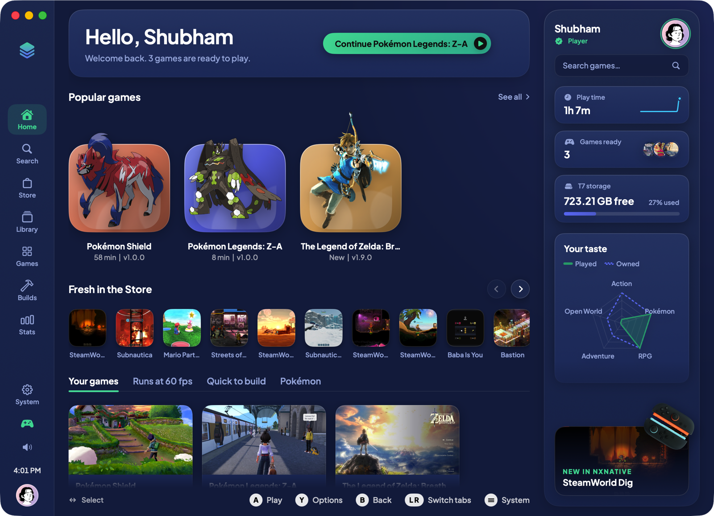
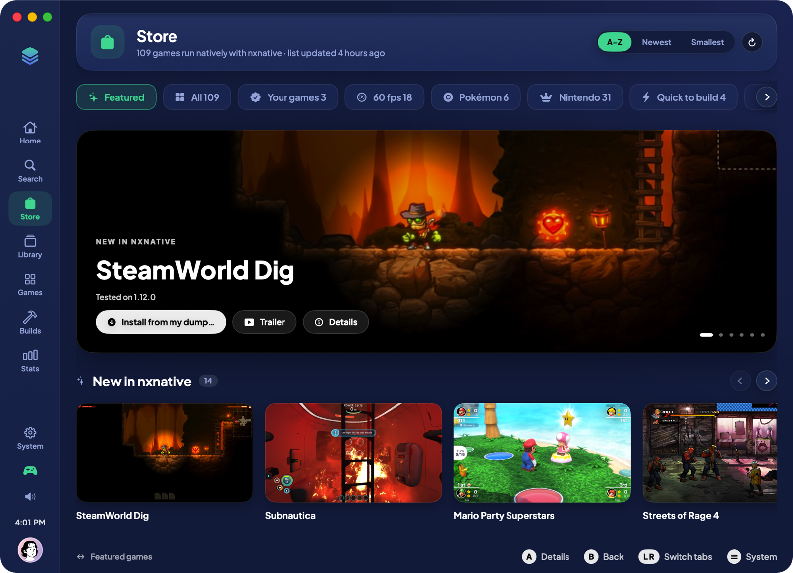
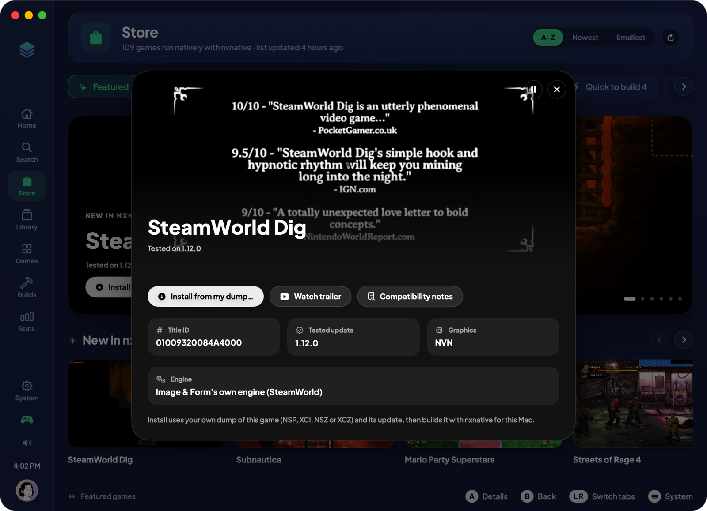
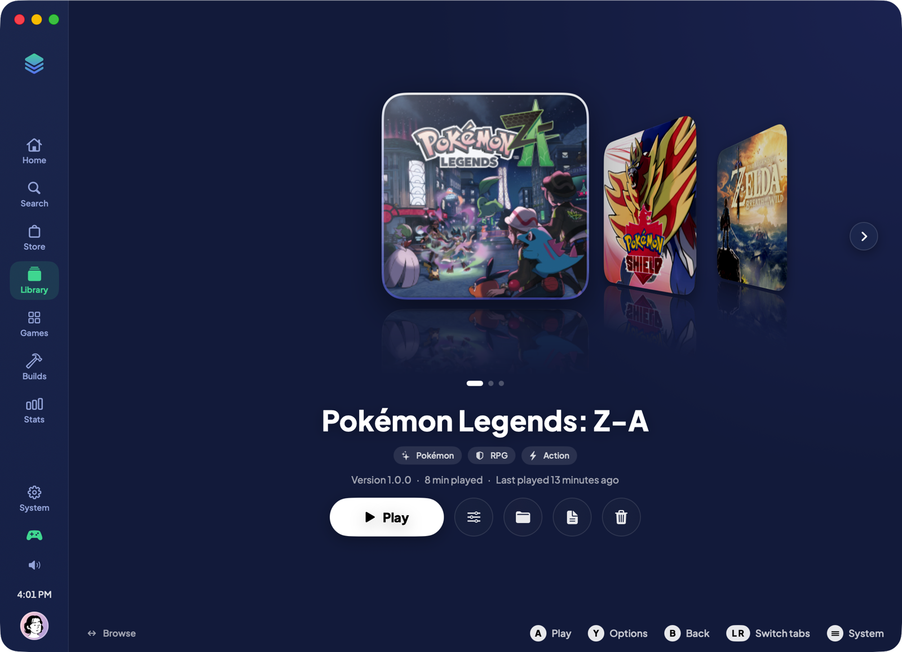
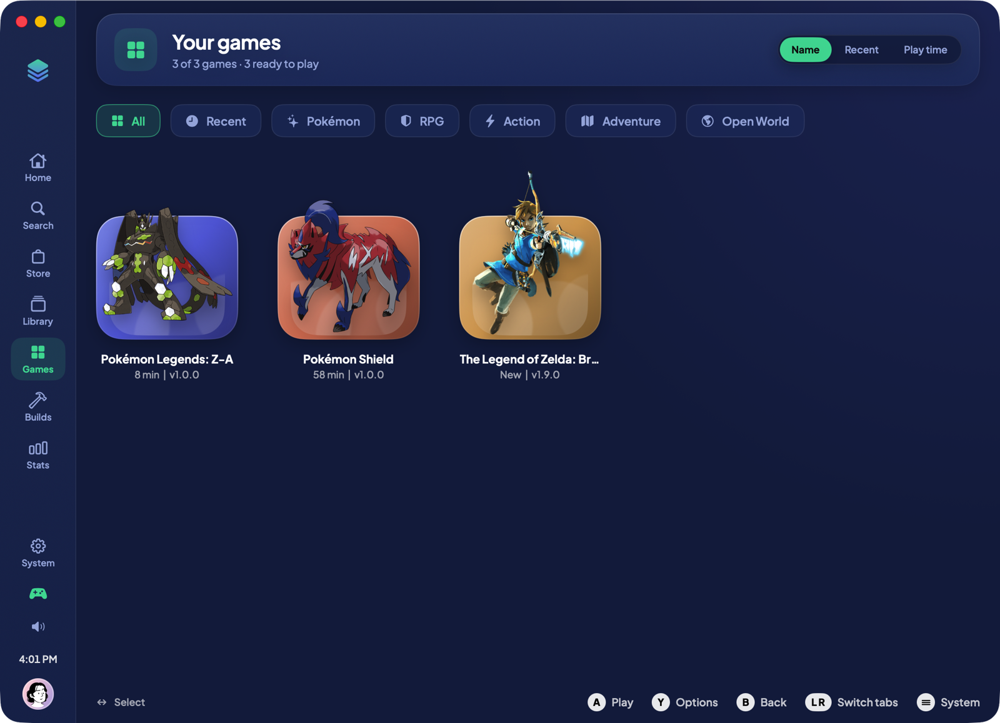
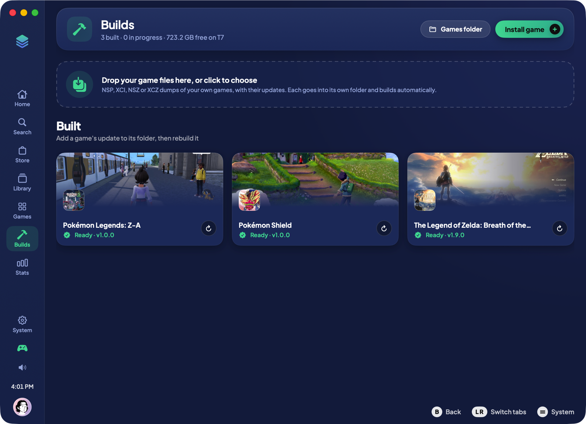
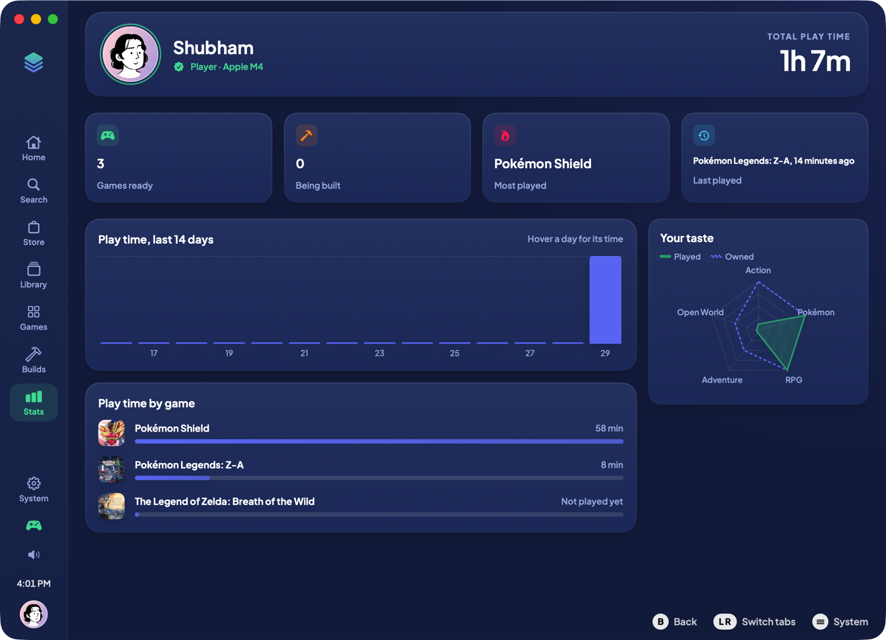
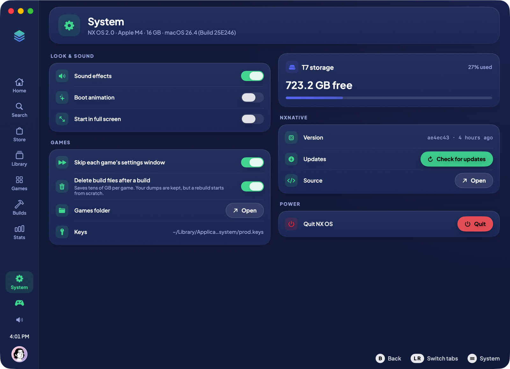

# NX OS

A console-style launcher for macOS that runs Nintendo Switch games natively on Apple silicon, built on top of [nxnative](https://github.com/seedds/nxnative) static recompilation.

NX OS finds every game nxnative has built, launches it full screen, tracks play time, and turns your own game dumps into Mac apps with live build progress. It is driven by mouse, keyboard or a game controller.



## Features

- **Home**: continue where you left off, popular games with character art, what is new in nxnative, and a side panel with play time, storage and your taste in genres.
- **Store**: every game nxnative supports (109 and counting), with filters, sorting, details, compatibility notes and in-app trailers. Installing always uses your own dump; NX OS never downloads games.
- **Library and Games**: your built games as cards or a grid, with Play, Rebuild, Show in Finder, Open Log and Delete Game.
- **Builds**: drop an NSP, XCI, NSZ or XCZ (plus its update) and NX OS builds it with nxnative, showing each stage in real time. Builds can be stopped, keep the Mac awake, and clean up their temporary files when they finish.
- **Stats**: total play time, a 14-day chart, time by game and a genre radar.
- **System**: storage, nxnative status, keys, sound, controller and power options.
- **Crash detection**: a game that quits within a minute is flagged with a hint, for example "Needs update 1.9.0", and does not count as played.
- Profile avatars, controller and keyboard navigation (A, B, Y, L/R, digits 1 to 7), Reduce Motion support and an app-only window.

| Store | Game details |
|---|---|
|  |  |
| **Library** | **Games** |
|  |  |
| **Builds** | **Stats** |
|  |  |
| **System** | |
|  | |

## Requirements

- An Apple silicon Mac on macOS 15 or later (the games nxnative builds need macOS 26)
- Xcode (for `swiftc`)
- A checkout of nxnative with its Python environment set up
- Your own `prod.keys` in `~/.switch/prod.keys`, and dumps of games you own

## Build

```sh
./build.sh
```

This compiles `Sources/*.swift` with `swiftc`, bundles the resources, signs the app and installs it to `/Applications/NX OS.app`.

If you create a code-signing identity called "NX OS Local Signing" in your login keychain, the script signs with it, so macOS keeps the external-drive permission between rebuilds. Without it, the app is signed ad hoc.

## Configuration

The paths are constants at the top of the sources:

| Constant | File | Default |
|---|---|---|
| `gamesRoot` | `Sources/Core.swift` | `/Volumes/T7/Games` |
| `nxnativeRoot` | `Sources/Services.swift` | `/Volumes/T7/Projects/Apps/nxnative` |

Each game lives in its own folder under `gamesRoot`, next to the dump it was built from. Saves stay in `~/Library/Application Support/nxnative`.

## Project layout

```
Sources/
  Core.swift      theme, fonts, the game library, play time and launching
  Services.swift  nxnative catalog, build queue and system info
  Shell.swift     window, sidebar, input handling and overlays
  Home.swift      home page and side panel
  Store.swift     store catalog, pages and trailers
  Pages.swift     shared components and the library
  Panels.swift    games, builds, stats and system pages
Resources/        icon, font, avatars, character art, controller art
```

## Credits

- Font: Plus Jakarta Sans (SIL Open Font License, `Resources/Fonts/OFL.txt`)
- Avatars: [DiceBear](https://www.dicebear.com) (see `Resources/Avatars/SOURCES.txt`)
- Controller photo: Crisco 1492, Wikimedia Commons, CC BY 4.0 (`Resources/Art/SOURCES.txt`)
- Character artwork belongs to Nintendo, The Pokémon Company and Game Freak, and is listed in `Resources/Characters/SOURCES.txt`

NX OS is a personal project. It is not affiliated with or endorsed by Nintendo. It does not include or download any games or keys.
